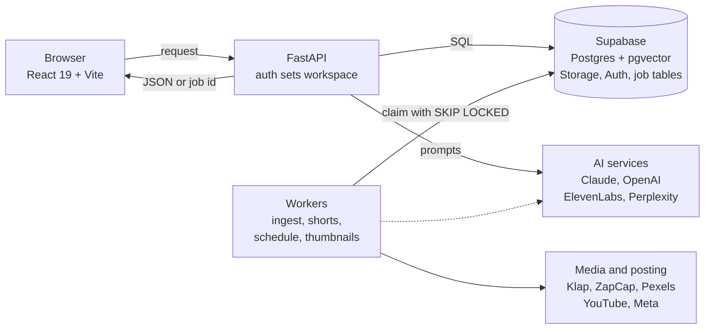
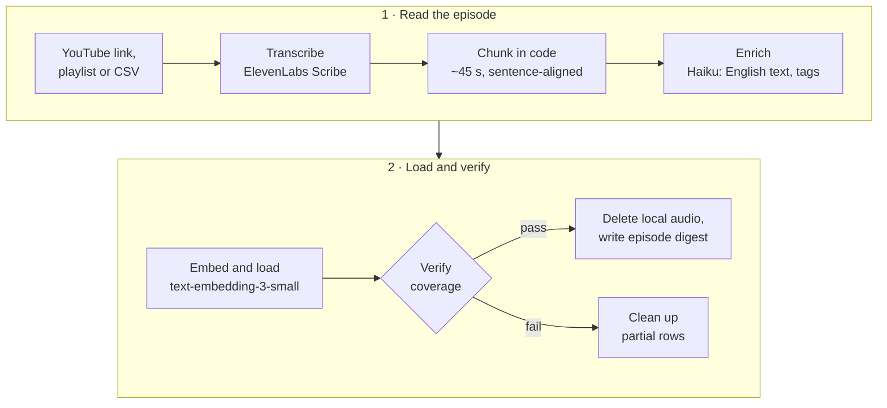
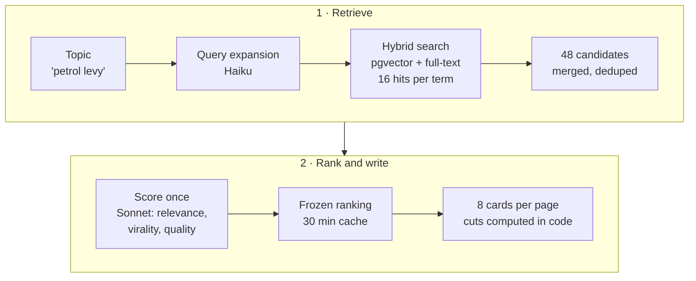
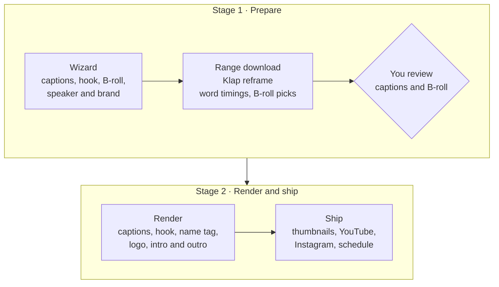

# Clipit

**Searchable clip intelligence for a podcast library. Find the best moments, turn them into finished 9:16 reels, post them.**

> [!NOTE]
> **README-only showcase.** Clipit was built at [East River Digital](https://eastriverdigital.com) (ERD) and runs in production there, so the source code is private. This repo documents what the system does, how it is built and the numbers it has produced. A live walkthrough is available on request. Current version: v3.2 (Nov 2026).

## 🧭 Overview

Editors were spending hours scrubbing long episodes to find one good 45-second moment, then hours more editing it. Clipit reads every second of a video library and makes it searchable by topic, trend or plain-language chat. It ranks the best moments and edits them into captioned, hooked, branded 9:16 shorts that post straight to YouTube and Instagram.

Type "petrol levy", get ranked clips in seconds, click **Make Short**, get a finished reel.

| Aspect | Detail |
|---|---|
| **Users** | Content teams. The first workspace is DigiTales, ERD's podcast. Multi-client since v3.0 (Oct 2026). |
| **Input** | YouTube episodes, playlists and channels, uploaded files up to 5 GB, and other creators' public channels (download only, credited, never published from Clipit) |
| **Output** | Scored clip cards, finished 9:16 shorts (captions, hook, B-roll, name tag, branding), per-person thumbnails, scheduled posts |
| **Languages** | Urdu-English code-switching, Roman Urdu and English |

## 📊 By the numbers

| Metric | Value |
|---|---|
| DigiTales library | 194 episodes, 16,000+ searchable clips |
| Clip unit | ~45 s, sentence-aligned, no gaps |
| First external client library | 30 videos → 1,720 clips |
| Search | 48 candidates scored once, 8 cards per page, score floor 5.0 / 10 |
| Cost per finished short | ~$1, mostly the reframe step |
| Full short render | ~29 min → ~12 min |
| B-roll overlay pass | 8.4 min → 108 s |
| Instagram insights load | 45 s → ~6 s |
| Max upload | 5 GB, sent in 8 MB resumable pieces |

## 🏗️ Architecture

The browser talks only to FastAPI. Fast work (search, chat) runs inside the request. Slow work (imports, renders, posts) becomes a job row that a background worker claims.

**Key idea:** the UI never waits on a long job. The API writes a `queued` row, a worker claims it with `FOR UPDATE SKIP LOCKED` and writes progress to the row, and the browser polls every 3 seconds. Leaving the page breaks nothing.

## ⚙️ How it works

### 1. Ingestion: video to searchable clips

- ✂️ **Chunking happens in code, not in the LLM.** When the model chose boundaries, clips looked complete but hid gaps. Back-to-back sentence-aligned windows make a gap impossible by construction. The LLM only translates and tags.
- 🌐 **Translate, then embed.** Guests mix Urdu and English, and Roman Urdu spelling varies ("mehngai", "mehangai"). Embedding the English translation lets a search for "inflation" find a clip where someone said "mehngai".
- ✅ **Verification gate.** Full transcript stored, no speech gap over 15 s, no overlaps, and transcript length at least 90% of YouTube's own duration (this catches half-downloaded files). Local audio is deleted only after every check passes.
- 🔁 Every step skips work already done, so a run can stop and resume safely.

### 2. Retrieval: how clip cards are found

Retrieval finds candidates, the LLM judges and writes, and code computes every timestamp and link.

| Stage | Detail |
|---|---|
| **Query expansion** | Haiku adds related terms: synonyms, other angles, Urdu phrasing |
| **Hybrid search** | pgvector cosine search (ivfflat, 1536 dims) finds meaning. Postgres full-text search (GIN index, `ts_rank`) finds exact names like "IMF". Guest, category, season and workspace are SQL `WHERE` filters. |
| **Score once** | One Claude Sonnet call scores the whole pool from 0 to 10: `composite = 0.40 × relevance + 0.35 × virality + 0.25 × quality`. Anything under 5.0 is never shown. |
| **Frozen ranking** | The sorted pool is cached for 30 minutes per topic, filter set and workspace. **Show more** walks down the same list, with no re-scoring and no repeats. |
| **Write cards** | Sonnet gets the top 8 clips with their neighbouring chunks and the whole-episode digest, plus the team's taste profile and the channel's real YouTube performance. It returns a title, the moment type, why it works and a hook. |
| **Cuts in code** | Haiku proposes a reel cut within ±22 s (15 to 55 s long). Code snaps it to real word timings, extends it through connectors ("and", "but", "so", "aur", "to") and never ends on a dangling word. |

- 🧠 **Personalisation without thumbs.** Searches, saves and shorts feed a taste profile. Home recommends the nearest unused clips to the average embedding of what the team saved and shorted (0.65 closeness + 0.35 clip strength, one per episode).
- 🔎 **Evaluation.** Real team queries are checked by hand against what an editor would pick, alongside usage (what gets saved and turned into shorts).

### 3. Make Short: clip to finished reel

Make Short runs in two stages. The user fixes captions and B-roll before the final render, so the paid reframe never runs twice.

| Stage | What happens |
|---|---|
| **Prepare** | Downloads only the clip's range (~15 to 30 MB instead of a ~180 MB video), reframes 16:9 to 9:16 with Klap, runs one ElevenLabs pass for word timings, and proposes B-roll from Pexels that Sonnet vision must score 6+ |
| **Review** | Fix caption words (timings stay exact), swap, prompt, upload or remove B-roll, or just download the reframe |
| **Render** | Captions (ZapCap templates or an in-house libass mode), hook card, name tag, logo, intro and outro, filler cuts, colour grade, browser-safe `yuv420p` |

- 🪝 **Hooks** are 3 to 6 words written by Haiku and checked by a second model for faithfulness, because hooks kept inflating claims. They are drawn with Pillow and placed away from the face (OpenCV).
- 🤫 **Filler cuts** remove ums, repeats and long pauses at word boundaries, but only where ffmpeg `silencedetect` confirms the audio is quiet. Captions and B-roll are remapped to the new timeline.
- 🧩 **Merge** joins up to 8 clips from anywhere: each part is trimmed to word-accurate bounds, loudness-normalised and crossfaded in one ffmpeg pass.
- 🎬 **AI reel editor (v3.2)** is modelled on the team's top 200 Instagram Reels (median 44 s, edited rather than straight cuts). Sonnet picks one continuous stretch, drops weak lines and can add an opening hook line. Code enforces a strong opener, no ending on a question, 30 to 75 s and at most 6 pieces. A failure goes back to the model with the reason, up to 3 times, before a safe continuous cut is used.
- 🖼️ **Thumbnails** use real frames: YuNet finds faces, SFace groups them by person, and Sonnet vision picks the best frame and writes a 3 to 7 word headline from what that person says.

### 4. Publish, schedule, measure

| Feature | How |
|---|---|
| **YouTube** | OAuth and resumable `videos.insert`. A 9:16 video under 3 minutes posts as a Short. Default visibility is Private. |
| **Instagram** | Graph API: create a REELS container, poll until `FINISHED`, then `media_publish`. Collaborators and tagged people are supported. |
| **Calendar** | A worker checks every 60 s and claims due posts with `SKIP LOCKED`. Posting to both platforms creates two rows, so one can fail without the other. |
| **Insights** | YouTube watch time, retention, traffic sources and "Clip this next"; Instagram reach, follower growth and best time to post. Connected stats feed back into ranking. |

### 5. Workspaces and roles

v3.0 turned the internal tool into a multi-client product: one codebase, one database, one deploy.

| Concern | Implementation |
|---|---|
| **Isolation** | Every data table has a `workspace` column. Auth middleware sets the workspace in a Python `contextvar` and every query filters on it. Background threads start through a binder so they keep it. |
| **No id leaks** | Ids in URLs and request bodies are checked against the workspace. A wrong workspace returns 404, not 403. |
| **Sessions** | Supabase Auth checks passwords. Clipit issues an opaque httpOnly session token stored in the database (30 days), so it can be revoked at once. |
| **Access** | Invite-only, with one-time join links valid for 14 days. Plans: `trial`, `active`, `internal`, with seat limits. |
| **Shared data** | Only public data is shared: trend keywords and transcripts of public channel videos. |
| **Migrations** | Additive only (new columns with defaults), so the running build never breaks during a schema change. |

| Permission | Owner | Admin | Member |
|---|:---:|:---:|:---:|
| Use every feature, change own password | ✅ | ✅ | ✅ |
| Invite people, remove members and admins | ✅ | ✅ | ❌ |
| Add or remove owners, change anyone's role | ✅ | ❌ | ❌ |

## ⚖️ Engineering decisions

| Decision | Chose | Over | Why |
|---|---|---|---|
| Vector store | pgvector in Supabase Postgres | Pinecone, Weaviate | Vector search, filters and joins in one SQL query, with no second store to sync |
| Search | Hybrid vector + full-text | Vector only | Embeddings blur exact names like "IMF" |
| Ranking | LLM judge on relevance, virality, quality | Cohere Rerank | A reranker scores relevance only; a content team needs "will this work as a reel" |
| Chunking | Fixed ~45 s windows in code | LLM or topic-based chunks | LLM boundaries left hidden gaps; fixed windows are predictable and gapless |
| Multilingual search | Translate to English, then embed | Multilingual embeddings on raw text | Roman Urdu spelling is inconsistent; translation normalises meaning first |
| Transcription | ElevenLabs Scribe, Whisper as gap-fill | Whisper, Deepgram, AssemblyAI | Best tested on Urdu-English code-switching, with exact word timings |
| Job queue | Postgres table + `SKIP LOCKED` | Celery + Redis | A few jobs at a time, and job state already lives where the UI polls |
| Reframe | Klap API, about $1 a clip | In-house speaker tracking | Weeks of work to match; the time went into edit quality instead |
| Frameworks | Direct SDK calls | LangChain, LlamaIndex | Retrieval is custom SQL with strict JSON schemas, and a framework hides what needs tuning |
| Live updates | 3 s polling | WebSockets | Jobs take minutes, and polling survives refreshes and proxies |
| Frontend | React + Vite build served by FastAPI | Next.js | The app sits behind a login, so server rendering adds nothing, and one container serves both |

## 🐛 Hard problems solved

| Problem | Root cause | Fix |
|---|---|---|
| Clips had hidden gaps inside episodes | The LLM chose cut points and skipped stretches | Chunking moved into code, and a gap check runs before audio is deleted |
| ffmpeg downloads from the server failed with "End of file" | YouTube media URLs are locked to the requesting IP, and ffmpeg can't tunnel HTTPS through an HTTP proxy | yt-dlp resolves the URL through the proxy, proxychains keeps ffmpeg on the same IP, and only the needed range downloads instead of ~180 MB and 11 min per clip |
| Worked locally, failed in the container | yt-dlp's challenge-solver script was cached on the dev machine | Fetched via `--remote-components`, with yt-dlp and deno versions pinned |
| Review video froze on one frame | Klap exports full-range `yuvj420p`, which some browsers freeze on | Always convert to limited-range `yuv420p` before hosting |
| Sentence logic silently failed for a client | Transcripts came back in Hindi or Urdu script, and the checks assumed `[a-z]` | Accept `।` `۔` `؟` as sentence ends and transliterate native script to Roman Urdu |
| Renders failed with "max clients reached" | psycopg2's `with conn` commits but doesn't close | A context manager that waits for a free pool slot and always closes |
| Best moments returned 0 cards, with no error | The JSON schema lacked `additionalProperties: false` at every level, and the 400 was swallowed | Fixed the schema and stopped silent exception handling on the main path |
| Gap-cutting removed real speech (49 s became 33 s) | Word timings missed some words | Cut only where `silencedetect` confirms silence |

## 🛠️ Tech stack

| Layer | Technology |
|---|---|
| **Frontend** | React 19, Vite, Tailwind CSS 4, React Router 7 |
| **Backend** | Python 3.12, FastAPI, Uvicorn, psycopg2 with raw SQL and a connection pool |
| **Data** | Supabase: PostgreSQL, pgvector (ivfflat, cosine), full-text search (GIN), Storage with resumable TUS uploads, Auth |
| **LLMs** | Claude Haiku 4.5 (expansion, translation, cut points), Claude Sonnet 5 and 4.6 (scoring, cards, edits, vision) |
| **Embeddings** | OpenAI text-embedding-3-small, 1536 dims |
| **Speech** | ElevenLabs Scribe, Whisper as fallback |
| **Trends** | Perplexity sonar, Google Trends (pytrends) |
| **Video** | ffmpeg, libass, Pillow, OpenCV (YuNet, SFace), yt-dlp |
| **Media APIs** | Klap (reframe), ZapCap (captions), Pexels (B-roll), gpt-image-2 (thumbnail restyle) |
| **Platforms** | YouTube Data API v3, YouTube Analytics API v2, Meta Graph API |
| **Deploy** | One multi-stage Docker image: Node 22 builds React, Python 3.12 serves API and UI on port 8000 |

## 🖼️ Screenshots

Grouped in the order a clip moves through Clipit. Click any **More from this step** to expand it.

### 1. Find the moment

<table>
  <tr>
    <td width="50%" align="center" valign="top">
      
       Trends: live keywords, each one opens ranked clip cards
    </td>
    <td width="50%" align="center" valign="top">
      
       Chat: ask in plain words, get scored clips back
    </td>
  </tr>
</table>

More from this step (5 screens)

 

<table>
  <tr>
    <td width="50%" align="center" valign="top">
      
       Home: four ways in, plus Recommended for you
    </td>
    <td width="50%" align="center" valign="top">
      
       Trends: pick a range and topics
    </td>
  </tr>
  <tr>
    <td width="50%" align="center" valign="top">
      
       Trends: fetching from Perplexity and Google Trends
    </td>
    <td width="50%" align="center" valign="top">
      
       Chat: clip cards inside the answer
    </td>
  </tr>
  <tr>
    <td colspan="2" align="center" valign="top">
      
       More like this: similar clips from other episodes
    </td>
  </tr>
</table>

### 2. Pick and edit a clip

<table>
  <tr>
    <td width="26%" align="center" valign="top">
      
       Clip card: score, reel script, actions
    </td>
    <td width="74%" align="center" valign="top">
      
       Edit lines: trim start and end on the script
    </td>
  </tr>
</table>

More from this step (3 screens)

 

<table>
  <tr>
    <td width="50%" align="center" valign="top">
      
       Edit lines: end dragged earlier, length updates live
    </td>
    <td width="50%" align="center" valign="top">
      
       Merge: clips selected from the bottom bar
    </td>
  </tr>
  <tr>
    <td colspan="2" align="center" valign="top">
      
       Merge: arrange and trim each part
    </td>
  </tr>
</table>

### 3. Make the short

<table>
  <tr>
    <td width="50%" align="center" valign="top">
      
       Review: fix caption words and B-roll before the final render
    </td>
    <td width="50%" align="center" valign="top">
      
       Done: the finished 9:16 short
    </td>
  </tr>
</table>

More from this step (8 screens)

 

<table>
  <tr>
    <td width="50%" align="center" valign="top">
      
       Step 1: captions, styled or simple
    </td>
    <td width="50%" align="center" valign="top">
      
       Step 2: hook line, placement and font
    </td>
  </tr>
  <tr>
    <td width="50%" align="center" valign="top">
      
       Step 3: B-roll, none, auto or select
    </td>
    <td width="50%" align="center" valign="top">
      
       Step 3: pick B-roll words from the script
    </td>
  </tr>
  <tr>
    <td width="50%" align="center" valign="top">
      
       Step 4: speaker name tag and branding
    </td>
    <td width="50%" align="center" valign="top">
      
       Step 5: review settings, then generate
    </td>
  </tr>
  <tr>
    <td width="50%" align="center" valign="top">
      
       Thumbnails box on the done screen
    </td>
    <td width="50%" align="center" valign="top">
      
       Thumbnails: one per person in the short
    </td>
  </tr>
</table>

### 4. Ship it

<table>
  <tr>
    <td width="50%" align="center" valign="top">
      
       Publish to YouTube as a Short
    </td>
    <td width="50%" align="center" valign="top">
      
       Post to Instagram as a Reel
    </td>
  </tr>
</table>

More from this step (6 screens)

 

<table>
  <tr>
    <td width="50%" align="center" valign="top">
      
       Schedule a post
    </td>
    <td width="50%" align="center" valign="top">
      
       Calendar: month view
    </td>
  </tr>
  <tr>
    <td width="50%" align="center" valign="top">
      
       Saved: clips from Trends
    </td>
    <td width="50%" align="center" valign="top">
      
       Saved: clips from Chat
    </td>
  </tr>
  <tr>
    <td width="50%" align="center" valign="top">
      
       Saved: finished shorts and their versions
    </td>
    <td width="50%" align="center" valign="top">
      
       Saved: shorts made from Channel Clips
    </td>
  </tr>
</table>

### 5. Library, uploads and other channels

<table>
  <tr>
    <td width="50%" align="center" valign="top">
      
       Library: every episode
    </td>
    <td width="50%" align="center" valign="top">
      
       Channel Clips: keyword search across all channels
    </td>
  </tr>
</table>

More from this step (8 screens)

 

<table>
  <tr>
    <td width="50%" align="center" valign="top">
      
       Library: best moments of one episode
    </td>
    <td width="50%" align="center" valign="top">
      
       Library: trim your own clip
    </td>
  </tr>
  <tr>
    <td width="50%" align="center" valign="top">
      
       Library: import from YouTube
    </td>
    <td width="50%" align="center" valign="top">
      
       Upload a video, up to 5 GB
    </td>
  </tr>
  <tr>
    <td width="50%" align="center" valign="top">
      
       Upload: best moments of your file
    </td>
    <td width="50%" align="center" valign="top">
      
       Channel Clips: channels and videos
    </td>
  </tr>
  <tr>
    <td width="50%" align="center" valign="top">
      
       Channel Clips: best moments or trim on one video
    </td>
    <td width="50%" align="center" valign="top">
      
       Channel Clips: trim your own
    </td>
  </tr>
</table>

### 6. Insights, Brand Kit and account

<table>
  <tr>
    <td width="50%" align="center" valign="top">
      
       Insights: YouTube
    </td>
    <td width="50%" align="center" valign="top">
      
       Insights: Instagram
    </td>
  </tr>
</table>

More from this step (3 screens)

 

<table>
  <tr>
    <td width="50%" align="center" valign="top">
      
       Brand Kit: logo, fonts, colours, live preview
    </td>
    <td width="50%" align="center" valign="top">
      
       Notifications bell
    </td>
  </tr>
  <tr>
    <td colspan="2" align="center" valign="top">
      
       Change password
    </td>
  </tr>
</table>

### Full-page captures

Long pages captured top to bottom (6 screens)

 

<table>
  <tr>
    <td width="41%" align="center" valign="top">
      
       Home with Recommended for you
    </td>
    <td width="59%" align="center" valign="top">
      
       Calendar: all posts
    </td>
  </tr>
  <tr>
    <td width="45%" align="center" valign="top">
      
       Trends: all clip cards
    </td>
    <td width="55%" align="center" valign="top">
      
       Insights: full YouTube dashboard
    </td>
  </tr>
  <tr>
    <td width="47%" align="center" valign="top">
      
       Insights: full Instagram dashboard
    </td>
    <td width="53%" align="center" valign="top">
      
       Brand Kit: full page
    </td>
  </tr>
</table>

## ⚠️ Limitations

| Limit | Detail |
|---|---|
| **Urdu word accuracy** | About 95%. Timing is exact, and spelling can be fixed on the review screen. |
| **YouTube quota** | The default API quota allows about 6 uploads a day. Volume needs a quota increase. |
| **App verification** | Google and Meta app verification is pending, so only listed test users can connect accounts. |
| **Thumbnails** | Need a visible face in the short. |
| **Uploads** | An upload in progress is lost if the server restarts mid-upload. Finished uploads are safe. |

## 🗺️ Roadmap

- [ ] Approval mode for scheduled posts, with email notices
- [ ] Split-screen reels
- [ ] TikTok as a trend source
- [ ] Viral-taste tuning from reference reels
- [ ] HNSW index and separate worker machines as libraries grow

## 📬 Contact

**Adeel Iqbal**

- 📧 Email: [adeelmemon096@yahoo.com](mailto:adeelmemon096@yahoo.com)
- 💼 LinkedIn: [linkedin.com/in/adeeliqbalmemon](https://linkedin.com/in/adeeliqbalmemon)
- 🐙 GitHub: [@adeel-iqbal](https://github.com/adeel-iqbal)
